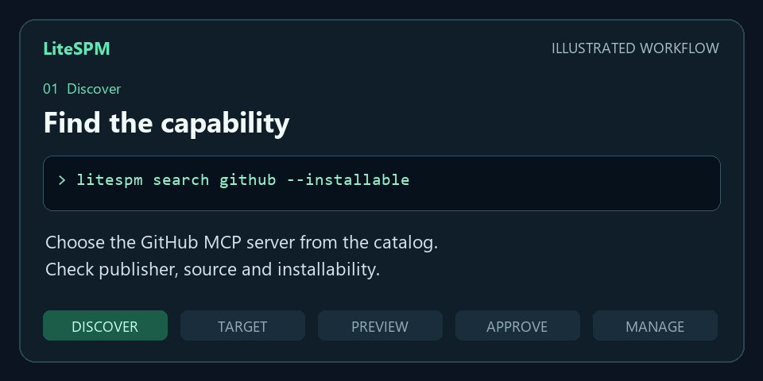

<div align="center">


# LiteSPM

**One package manager. Every AI agent.**

Discover, preview, install and manage MCP servers, skills and plugins across supported AI coding agents.

[](https://www.npmjs.com/package/litespm) [](https://github.com/sarv-projects/LiteSPM/actions/workflows/ci.yml) [](LICENSE)

[Marketplace](https://lite-spm-nine.vercel.app/marketplace) · [Quickstart](https://lite-spm-nine.vercel.app/docs/getting-started) · [Compatibility](https://lite-spm-nine.vercel.app/docs/agent-compatibility) · [Releases](https://github.com/sarv-projects/LiteSPM/releases)

</div>

## Why LiteSPM?

Claude Code, Codex, Cursor and OpenCode have different config files and setup steps. LiteSPM gives you one local workflow across compatible hosts.

| Principle | What it means |
|---|---|
| Cross-agent | One management workflow across supported hosts. |
| Reviewable | Inspect the plan with `--dry-run` before applying changes. |
| Reversible | Track managed changes, remove entries and restore eligible backups. |
| Local-first | Manage tools on your own machine, without a LiteSPM account. |



*Illustrated workflow, not a live recording. Actual output and compatibility vary by version and package.*

## Quickstart

```sh
npm install -g litespm
litespm
```

The npm launcher requires Node.js 22.22.2+. Native binaries are available from [GitHub Releases](https://github.com/sarv-projects/LiteSPM/releases). Review standalone installer scripts before executing them.

### One package, two agents

Connect Claude Code and Codex using the wizard, then search and preview a compatible package:

```sh
litespm search github --installable
litespm install mcp:builtin:mcp-registry:io.github.github-github-mcp-server --agent claude-code --agent codex --dry-run
```

Review the source, targets, plan and required credentials. To proceed, repeat without `--dry-run` and follow the approval flow. Registration does not guarantee the third-party runtime is ready; authentication is publisher-specific.

```sh
litespm list
# Replace INSTALL_ID with the recorded installation ID:
litespm install remove INSTALL_ID
```

Removal reconciles managed entries. Restoration is a separate operation using a recorded backup; inspect conflicts and later edits.

## Capabilities

| Type | Workflow |
|---|---|
| MCP servers | Register publisher-declared commands or endpoints with compatible hosts. |
| Skills | Add, find, update, use, adopt, list and remove skills. |
| Plugins | Install portable MCP/skill components from eligible pinned sources. Host-specific hooks, commands, agents and LSP components are not installed; partial installs require consent. |
| Marketplace | Browse via web, CLI or supported in-agent integrations. |

The current source registry has **52 MCP host adapters** (47 remote-capable) and **81 skill targets**. The published v0.6.0 tag documents 50 MCP hosts and 81 skill targets; check your installed version. These counts overlap and are not 133 distinct agents. Discovery-only listings are not automatically installable. Compatibility does not mean every package was tested on every host.

Run `litespm host list` for your installed version. See [AGENTS.md](AGENTS.md) and [STATUS.md](STATUS.md) for evidence and limitations.

## Marketplace in your agent

In the current source tree, Pi and OpenCode have tested interactive workflows; GitHub Copilot CLI has a tested select flow in experimental mode. Claude Code registration was verified, but its pane was not observed live in the recorded tests. Other integrations may be prompt-based or unverified.

```sh
litespm marketplace
litespm catalog sync
litespm skills find pdf
litespm skills list
```

See the [in-agent guide](https://lite-spm-nine.vercel.app/docs/in-agent-marketplace).

## Security and privacy

Agent-originated installs require human approval bound to the plan. This is consent, not a sandbox against same-user processes. Supported configuration edits use backups and ownership-aware removal. Release signatures are verified by default; catalog verification requirements are documented in [SECURITY.md](SECURITY.md). Upstream verification labels are not independent audits. The CLI has no product telemetry; network downloads, website requests, feedback and assistant services have separate data flows.

Report vulnerabilities privately through [Security Advisories](https://github.com/sarv-projects/LiteSPM/security/advisories/new).

## Build and contribute

```sh
git clone https://github.com/sarv-projects/LiteSPM.git
cd LiteSPM
go build -o litespm ./cmd/litespm
go test ./...
cd web
bun install --frozen-lockfile
npm run build
```

See [CONTRIBUTING.md](CONTRIBUTING.md), [release notes](docs/RELEASE-NOTES.md), [changelog](CHANGELOG.md), [architecture](ARCH/) and [security](SECURITY.md). Use the Go version in go.mod.

Apache-2.0. Third-party listings remain subject to their own licenses.
