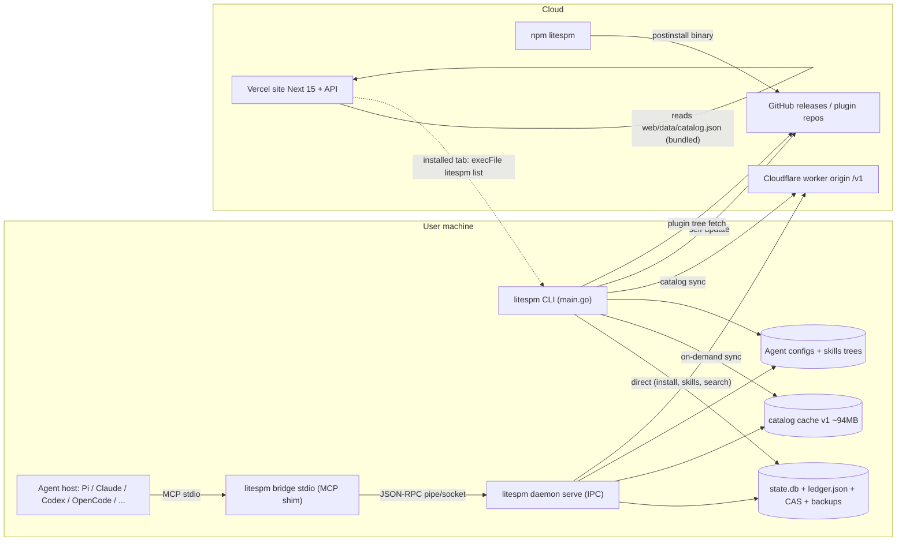
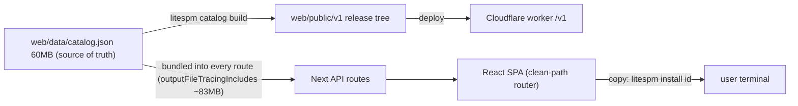
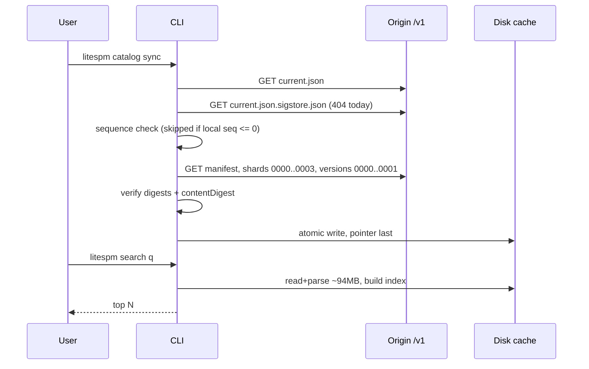
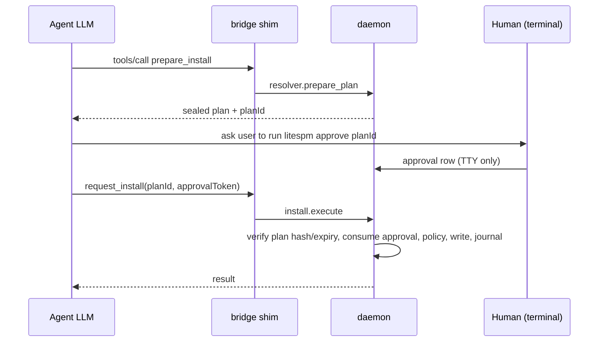
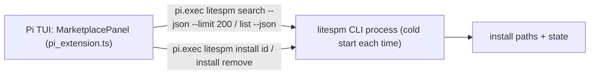
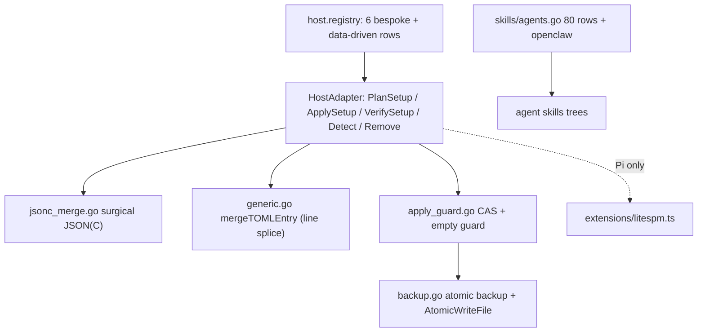
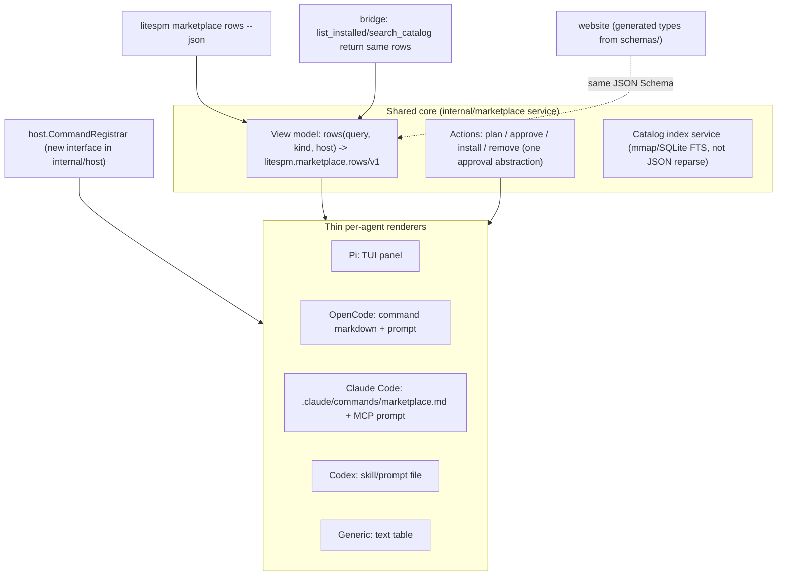

# LiteSPM — Evidence-driven audit, November 2026

Scope: repo `main` @ `1cb826c` plus another engineer's uncommitted edits (not touched); site https://lite-spm-nine.vercel.app; catalog origin https://litespm.sarveshbh-2022.workers.dev. Companion file: [LEDGER.md](LEDGER.md) (what was read, run and left undone).

Conventions: **V** = verified by me (read / ran / fetched). **V-d** = verified by a delegated read-only investigation that returned file:line (load-bearing items spot-checked). **S** = suspected. Line numbers refer to the working tree at audit time; `main.go` is being edited, so they will drift.

**Prior evidence reused, not redone:** build/vet/all Go tests and npm wrapper tests pass on Windows; `litespm@0.6.0` installs with Sigstore verification (repo says 0.6.1, unpublished); `catalog sync` on 0.6.0 dies at 30 s because the loaded config always carries `Network.Timeout=30s` (fix already visible in `catalogSyncTimeout`, `main.go:~313`); `plugin:claude-official:mongodb` failed on `"skills": "./skills/"` (fix visible: container handling in `install_plugin_skills.go:~150`); Pi is the only agent with a real popup (pty-verified, Pi 1.5.0); OpenCode 2.0.32 ignores `mcp.servers`; `install` without a TTY needs no approval while `skills add` refuses; Pi popup lets Enter hit non-installable rows and shows raw Go `map[...]` text.

---

## 0. Executive summary

LiteSPM's *core* is unusually careful for a project of its age: plan → hash-sealed approval → journaled write → byte-exact restore, with a real crash-recovery path. The weaknesses are at the edges: **(a)** trust in the catalog is TLS-only by default, **(b)** the human-approval story is stronger in docs than in the CLI, **(c)** the "in-agent marketplace" is real for exactly one agent, **(d)** the CLI is slow on the full 69k catalog, and **(e)** the website and docs describe flags and counts the binary does not have.

Production readiness: **beta — fit for supervised use on a developer machine, not yet for unattended/CI use or for a "secure by default" claim** (§13).

Top 15 findings (full register §12):

| # | ID | Sev | One line |
|---|---|---|---|
| 1 | F-01 | High | Live origin publishes **no** `current.json.sigstore.json` (404) and signature enforcement is off by default → catalog authenticity = TLS only; rollback guard also off when local sequence ≤ 0 |
| 2 | F-02 | High | `litespm install` with no TTY/`--yes` self-approves; the approval row is stamped `human-cli`/`cli-tty` anyway |
| 3 | F-03 | High | `search` loads/parses ~94 MB: 2.6 s warm, 18–24 s cold, ≈520 MB RSS on this box; the Pi popup shells out to it |
| 4 | F-04 | High | Install policy is skipped entirely when the engine has no policy (`engine.go` `if e.policy != nil`) |
| 5 | F-05 | Med | Daemon `catalog.search` runs an unbounded-ish on-demand `Sync` inside a request handler and discards the error |
| 6 | F-06 | Med | No hooks/workflows/commands/subagents/LSP install path exists anywhere; refused unless `--allow-partial`, then skipped |
| 7 | F-07 | Med | `/marketplace` is registered by LiteSPM in **Pi only**; "bootstrap/companion skill" claims for Claude/Codex/Grok have no code (`RequiresBootstrapSkill` is never read) |
| 8 | F-08 | Med | `litespm uninstall --anything-else` performs the real removal (unknown flags ignored) |
| 9 | F-09 | Med | Website: no CSP/HSTS/XFO headers; `javascript:`-capable hrefs; substring host checks; unquoted shell in copy buttons |
| 10 | F-10 | Med | Site/docs show commands the CLI rejects (`--global` on install; `install neon` short name) |
| 11 | F-11 | Med | Two incompatible "installable" rules (web `availabilityOf` vs Go `IsInstallable`) and a third in `/api/trending` |
| 12 | F-12 | Med | `release.yml`: workflow-wide write/OIDC, floating tags, GitHub release before npm tests (prior) |
| 13 | F-13 | Med | `bridge`, `agent`, `doctor`, `host` parsers silently swallow unknown/missing args; exit 1 instead of 2 |
| 14 | F-14 | Med | Two install/rollback architectures (CAS `Engine` vs `InstallTxn`+`Journal`); the Engine looks unreachable for shipped kinds (S) |
| 15 | F-15 | Med | Every TTY invocation can silently replace the binary (auto-update) before the requested command runs |

---

## 1. CLI command inventory

Dispatch: `switch command` in `cmd/litespm/main.go:84–250` (V). `maybeAutoUpdate(os.Args[1:])` runs first (`main.go:~66`; TTY-only, see F-15). Bare `litespm` → `runSetup(nil)`. Unknown command → help to stdout, **exit 2**. Exit contract (ARCH/20): 0 ok · 1 failed/refused · 2 usage · `doctor` 10/20/30/40/50/60/70 by category.

| Command (aliases) | Entry (file:line) | Flags / subcommands | Filesystem effects | Network | TTY / approval | Exit codes |
|---|---|---|---|---|---|---|
| `version`,`--version`,`-v` | main.go:85 | – | none | none | no | 0 |
| `setup` / bare | `runSetup` main.go:598 | `--agent <id>`, `--all`/`-a`, `-h` | host config + backup in `BackupsPath()`; Pi also writes `extensions/litespm.ts` | none | wizard needs TTY; `--agent/--all` do not | usage 2 (`setupUsageError`), 1 on failed host; no TTY w/o flag → 1 |
| `init [name]` | `runSkillsInit` skills_init.go:93 | name | scaffolds SKILL.md in cwd | none | no | 0/1/2 (S) |
| `self-update`,`update` | `runSelfUpdate` main.go:347 | `--force`,`-h` | replaces running exe; staging dir | GitHub release manifest + asset + Sigstore bundle | no | 1 on any failure |
| `doctor` | `runDoctor` main.go:2437 | `--repair`/`-r`/`--fix`, `--yes`/`-y` (undocumented aliases; other args ignored) | opens state DB; `--repair` mutates | none | `--repair` asks unless `--yes` (S) | 0 or category code 10–70 |
| `audit` | `runAudit` audit.go:94 | `--ci --json --sarif <p> --dataset <p>` | `--sarif` writes file | none (S) | no | 2 usage; 1 on error-severity finding |
| `marketplace`,`market` | `runMarketplace` marketplace.go:48 | `--url`, `--no-open`, `-h`; **`rows`** subcommand (new, uncommitted) | none | opens browser to `$LITESPM_WEB_URL` or the Vercel URL | no | 2 usage/non-http(s); 0 even if browser launch fails |
| `marketplace rows` | `runMarketplaceRows` marketplace_rows.go:196 | `[query] -q --host/--agent/-a --kind/--tab --limit(200) --installable --json`; schema `litespm.marketplace.rows/v1` | read-only (index + state DB) | none | no | returns code (values S) |
| `search` | `searchQueryArgs` main.go:1331 / `runSearch` :1387 | `<query> --json --limit 1..500`; other `--x` → usage error | read-only (loads whole catalog cache) | none | no | 2 usage |
| `auth` | `runAuth` auth.go:85 | `login <provider> --client-id --auth-url --token-url [--client-secret-env --scope… --timeout]`, `status`, `logout <profile-id>` | state DB rows + OS vault | loopback listener + user-supplied token URL | login opens browser | (S) |
| `adopt` | `runAdopt` adopt.go:117 | `<name> --host <id>` (+`--scope`,`--workspace` in code, not in help) | ledger/state only; **no host-config write** | none | no | 2 usage (incl. `--help`!), 1 fatal |
| `install`,`add`,`i` | `runInstall` main.go:1676; flags :1571 | `<id> --version/-v --scope/-s --workspace/-w --host… --agent/-a… --all-detected --env… --force/-f --yes/-y --frozen --dry-run --allow-partial`; `install remove <installId>` | state DB plan+approval rows; skills trees + ledger; host MCP config (+backup); plugin: fetch pinned git tree | local index only; plugin → git remote | TTY: prints plan, `Install this plan? [Y/n]`. **No TTY: no prompt, self-approves** (F-02) | 2 flag errors/bad workspace/`--allow-partial` on non-plugin; 1 refusals/failures; 0 success, dry-run, declined |
| `approve` | `runApprove` install_authz.go:346 | `<plan-id>` | approval row; prints token | none | **requires TTY on stdin+stdout**, types `yes` | 2 usage; 1 non-TTY/bad/expired/declined |
| `grant` | `runGrant` grant.go:99 | `<cap-id>`,`list`,`revoke <id>` | grant rows | none | `grant <id>` requires TTY | 2 usage; 1 |
| `lock` | `runLock` lock.go:323 | `--check --sbom cyclonedx-json\|spdx-json --verify` | writes `litespm.lock` (S) | none | no | (S) |
| `copy` | `runCopy` copy.go:195 | `[items] --from --to --conflict --apply --yes --exclude --dry-run --project --global` | target host config via install path | none | TTY or `--apply --yes` | (S) |
| `import` | `runImport` import.go:134 | `-h --project --json --apply --yes --dry-run` | `--apply` writes | none (S) | TTY or `--apply --yes` (S) | (S). **No help page** (F-23) |
| `catalog sync` | `runCatalogSync` main.go:2057 | – | replaces cache under `DataRoot/v1` atomically | `Catalog.RegistryURL` (default workers.dev) | no | 1 on failure; old cache kept |
| `catalog build` | `runCatalogBuild` main.go:2306 | stdlib `flag`: `-dataset -out -prev -release-id -sequence -created-at -materialize -verify` | writes `/v1` tree under `-out`; `-verify` read-only | none | no | 1; 2 from `flag.ExitOnError` |
| `catalog` other | main.go:~160 | – | – | – | – | 2 (usage to **stdout**) |
| `daemon serve` | `runDaemonServe` main.go:2580 | `serve` | dirs, daemon.lock, state DB, CAS, staging; startup recovery | none | needs OS vault else exit 1 | 2 usage; 1 fatal |
| `bridge` | `runBridge` main.go:787 | `--host` (default `generic`), `--workspace/-w`, `-h`; **no `stdio` token required** | none; may auto-start daemon | local IPC only | stdio MCP | 1 only on serve error |
| `host list/detect/setup/remove` | `runHostCommand` main.go:858 | `setup <id>`, `remove <id>\|--all\|all` | bridge entry + backup | none | no | 2 usage; 1 failure; `remove --all` returns 0 even with unreadable hosts |
| `uninstall` | `runUninstall` main.go:976 | `--dry-run` only; **all other args ignored** | strips bridge entry from every host (backups kept) | none | **no prompt** | 1 path error; else 0 |
| `restore` | `runRestore` restore.go:412 | `<installId>`/`--host <id>`, `--dry-run` | replays backups | none | no; refuses if node edited | (S) |
| `agent list/resolve` | `runAgentCommand` main.go:1171 | `--registry --file --json`, `resolve <id>` | read-only | ACP registry fetched **before** subcommand check | no | 2 no/unknown subcmd; 1 load failure |
| `capabilities`,`caps` | `runCapabilities` capabilities.go:38 | `list/search/describe/refresh` | `refresh` starts servers, writes capability rows | none | no | (S) |
| `invoke` | `runInvoke` capabilities.go:413 | `<cap-id> --arguments '<json>'` | runs tool via policy | none | grant required | non-zero on tool error (help) |
| `skills add` | `runSkillsAdd` skills_add.go:180 (parser :95) | `<source> --skill… --agent/-a… --global/-g --scope --list/-l --yes/-y --all --force/-f --full-depth --json` | skills trees, ledger, backups | git clone / direct download | TTY prompts; **non-TTY without `--yes` → refuse** | 2 parse; 1 many; cancel 0 |
| `skills list/ls`,`update`,`remove/rm`,`use`,`find`,`adopt` | skills_remove.go:148, skills_update.go:159, skills_remove.go:381, skills_use.go:150, skills_find.go:135, skills_adopt.go:131 | see `skillsUsageLine` main.go:~58 | ledger-confined | add-like for update/use | pickers only on TTY | bare/unknown 2; `-h` 0 |
| `list`,`inventory` | `runList` list.go:292 | `[agents\|mcp\|skills\|plugins] --agent --managed --observed --drifted --project --global --kind --json` | read-only | none | no | int |
| `help`,`--help`,`-h` | `runHelp` help.go:724 | `[command\|concepts]` | none | none | no | 2 unknown/many; 0 |

Reading notes: the inventory is V for rows whose entry I read (dispatch, install, setup, host, bridge, agent, catalog, daemon, doctor, uninstall, approve, skills add, marketplace) and V-d/S for the rest (flagged "S"). Distinct behaviours worth recording:

* `install` approval: `installConfirmWanted` (main.go:~2023) is true only when `!--yes && !--dry-run && stdin&&stdout are TTY`; otherwise `confirm == nil` and `authorizeHumanInstall` (install_authz.go:~274–312) saves the plan, records an approval with actor `human-cli` / channel `cli-tty` and consumes it immediately (V).
* `skills add` never touches the state-DB plan/approval path: consent is the prompt/`--yes`; policy "ask" is auto-answered true (skills_add.go:~725) (V-d).

---

## 2. Feature verification and agent compatibility

Status vocabulary: **FIV** Fully implemented and verified · **IBU** Implemented but unverified · **PART** Partially implemented · **UI** UI only · **DOC** Documented but not implemented · **UNS** Unsupported · **NI** Not investigated.

### 2.1 Feature matrix

| Feature | Website | CLI | In-agent | Core | API/Registry | Tests | Actual status |
|---|---|---|---|---|---|---|---|
| Browse/search catalog (69 376 rows: 48 418 mcp, 20 320 skill, 638 plugin) | Explore/Marketplace, `/api/litespm/list` over `web/data/catalog.json` | `search`, `skills find` | `search_catalog` tool, `/marketplace` prompt (text), Pi panel | `catalog.Client.Search` | `/v1` release tree | unit | **FIV** (functional) / slow: F-03 |
| Catalog sync with verification | – | `catalog sync` | daemon on-demand sync | `Client.Sync` digest chain | pointer+manifest+shards | unit, replay | **PART** — digest chain strong; origin signature not published (F-01); 30 s timeout bug fixed in tree |
| Install skill | copy button | `install`, `skills add` | `prepare_install`→`request_install` | skills ledger | – | unit/e2e | **FIV** |
| Install MCP server | copy button | `install` | same | host merge + journal | – | unit/e2e | **FIV** for 6 bespoke hosts via tests; others **IBU**; OpenCode 2.0.32 **PART** (prior) |
| Install plugin (servers+skills) | copy button | `install` (+`--allow-partial`) | same | `install_plugin*.go` | pinned git tree | unit | **PART** — portable parts only; container-skills fix in tree |
| Plugin **hooks / commands / subagents / LSP / workflows** | FAQ says "extras" | refused `LPSM-INSTALL-PARTIAL` or skipped | – | counted, never projected | – | unit | **UNS** by design (F-06) |
| Remove / undo | – | `install remove`, `restore`, `uninstall`, `skills remove` | markdown prompt only | `Orchestrator`, ledger | – | unit | **FIV** |
| Adopt existing entries | – | `adopt`, `skills adopt` | `adopt_capability` | ledger only | – | unit | **FIV** |
| Human approval gate | – | `approve`; `install` TTY prompt | `request_install` requires token from `approve` | `authorizeInstallExecute` | – | unit | **PART** — agent path strict; CLI path fail-open (F-02) |
| Lockfile / frozen / SBOM | docs | `lock`, `install --frozen` | – | `internal/lockfile` | – | unit | **IBU** (bodies not read) |
| Invocation of installed MCP tools | – | `capabilities`, `invoke`, `grant` | `search/describe/invoke_capability`, `get/cancel_invocation` | `invocation.Engine`, receipts | – | unit | **IBU** (not run live) |
| In-agent marketplace popup | "windowed marketplace → `litespm marketplace`" | `marketplace` (browser) | Pi only | `pi_extension.ts` | – | pty run (prior) | **FIV for Pi; UNS elsewhere** (F-07) |
| Browser marketplace "Installed" tab | `/api/litespm/installed` execs local CLI | – | – | – | – | – | **PART** — works only when site served from the user's machine |
| ACP agent registry | `/agents` | `agent list/resolve` | – | `internal/agent` | external registry | unit | **PART** — resolves launch specs, never installs |
| Auth (OAuth PKCE to providers) | – | `auth` | – | vault | – | unit | **NI** |
| Self-update (Sigstore) | – | `self-update` + auto | – | `internal/update` | GitHub | unit | **FIV** (0.6.0 verified prior) |
| Feedback / trending / assistant | yes | – | – | – | `/api/litespm/{feedback,view,trending,assistant}` | – | **UI/PART** — needs DB/LLM env |

### 2.2 Agent compatibility matrix

Only Pi, OpenCode (partly) and the generic write path have live evidence. Everything else is unit-tested adapters.

| Agent | Integration (what setup writes) | Command registration | Popup | MCP | Skills | Plugins | Hooks | Workflows |
|---|---|---|---|---|---|---|---|---|
| Pi (`pi-agent`) | `~/.pi/agent/mcp.json` `mcpServers.litespm` **+** `extensions/litespm.ts` (only if absent) piagent.go:129–183 | `pi.registerCommand("marketplace")` pi_extension.ts:384 | **FIV** TUI panel via `ctx.ui.custom` (shells to CLI) | FIV | `.agents/skills` (project+global) IBU | MCP+skills IBU | UNS | UNS |
| Claude Code | `~/.claude.json` `mcpServers.litespm` (`CLAUDE_CONFIG_DIR`) | none written; `RequiresBootstrapSkill:true` is dead (claudecode.go:24, never read); host may expose MCP prompt (S) | none | IBU | `~/.claude/skills`, project `.claude/skills` IBU | IBU | UNS (plugin hooks refused) | UNS |
| OpenAI Codex | `$CODEX_HOME/config.toml` `[mcp_servers.litespm]` | none; `RequiresBootstrapSkill:true` dead | none | IBU | `.agents/skills`, `~/.codex/skills` IBU | IBU | UNS | UNS |
| OpenCode | `opencode.jsonc/json` `mcp.servers.litespm` (v2 container) | MCP prompt appears as `/litespm:marketplace` on v2.2.x (AGENTS.md; prior evidence: text only) | none | **PART** — 2.0.32 ignores `mcp.servers` (flat `mcp.<name>` works on 2.0.32/2.2.6) | `$XDG_CONFIG_HOME/opencode/skills` IBU | PART | UNS | UNS |
| Cline | `~/.cline/data/settings/cline_mcp_settings.json` (legacy globalStorage probed last) | none | none | IBU | `~/.agents/skills` IBU | IBU | UNS | UNS |
| Grok Build | `$GROK_HOME/config.toml` `[mcp_servers.litespm]`, project `.grok/config.toml` | none ("companion command hook" in AGENTS.md has no code) | none | IBU | `.grok/skills` IBU | IBU | UNS | UNS |
| Qwen Code | `~/.qwen/settings.json` via generic row (targets_data.go:977) | none; `/marketplace` unknown on 0.14.4 (AGENTS.md) | none | IBU | `.qwen/skills` IBU | IBU | UNS | UNS |
| Other 46 hosts | data-driven rows (`targets_data.go`, 46 `ID:` rows + 6 bespoke ≈ 52) | none | none | IBU (entry-shape per row; 4 refuse remote) | 80 skill rows + openclaw | any host with an entry layout for the scope (install_plugin.go:482–498) | UNS | UNS |

**Hooks and workflows — answer from code (V):** there is **no install path**. `PluginInstallManifest` counts `commands`, `agents`, `hooks`, `lspServers` and "NEVER projects" them (`internal/interop/plugin_install.go:16–20, 79–110, 146–151`, V-d). `skippedPluginComponents` (`install_plugin_skills.go:~66–100`, V) gives reasons ("LiteSPM never executes a plugin's hooks"); `install_plugin.go:~667` refuses with `LPSM-INSTALL-PARTIAL` unless `AllowPartial` is sealed into the plan. Policy tier-1 hard-denies `cmd:`/`command:` targets (`policy/engine.go:~352`, V-d). A plugin with no MCP server and no skill is refused outright (`install_plugin.go:~650`). "Workflow" has no type anywhere in `internal/` (V-d grep). `domain` declares kinds `agent|rule|hook|tool|lsp|connector` (`models.go:14–19`) but only skill/mcp/plugin are `InstallWired`.

---

## 3. API and data-contract inventory

### 3.1 Daemon IPC (JSON-RPC 2.0, line-delimited)

Transport: Windows named pipe `\\.\pipe\litespm-daemon-<hash>`, SDDL `D:(A;;GA;;;OW)` (`transport_windows.go:12`); unix socket 0600 in 0700 dir; Linux `SO_PEERCRED`, macOS `LOCAL_PEERCRED`, others dir-permission only; peer identity returned in handshake (`ipc/server.go:96`). Handshake required before any method (10 s), idle 30 min, 64 concurrent handlers then `-32004` (V-d).

| Method | main.go | Params → result | Bridge tool | Gate |
|---|---|---|---|---|
| `daemon.handshake` | ipc/server.go:74 | `{clientKind}` → `{daemonVersion,protocolVersion,pid,peerAuth}` | – | – |
| `tools.list` | 2790 | `{projectRoot?}` → `{count,installs[]}` | `list_installed` | read |
| `catalog.search` | 2864 | `{query,kinds[],category,limit}` → `{count,results[]}` | `search_catalog` | read; **may `Sync`** (F-05) |
| `catalog.get_item` | 2924 | `{id,version}` → Listing (exact id) | `get_extension` | read |
| `resolver.prepare_plan` | 2943 | `{id,version,scope,projectRoot,allowPartial}` → sealed plan (+`droppedHosts`) | `prepare_install` | writes plan row |
| `install.execute` | 3038 | `{planId\|listingId, approvalId\|approvalToken,…}` | `request_install` | needs human-cli/cli-tty approval bound to plan hash |
| `install.remove` | 3284 | `{installId}` | – | **no approval** (same-uid trust) |
| `skills.list` / `load_body` / `read_resource` | 3310/3368/3406 | – | `load_skill`, `read_skill_resource` | read; 8 MiB cap; traversal/symlink refused |
| `capabilities.search` / `describe` | 3453/3499 | – | same names | read |
| `provider.probe` | 3532 | `{providerId}` | – | read |
| `provider.invoke` | 3561 | `{capabilityId,arguments,deadlineMs,async}` | `invoke_capability` | policy tiers + grant |
| `invocation.get` / `cancel` | 3614/3636 | `{invocationId}` | `get_/cancel_invocation` | – |
| `adopt.execute` | 3663 | `{name,hostId,scope,workspace}` | `adopt_capability` | audited, no host write |
| `host.detect_config` / `host.apply_setup` | 3709/3718 | `{hostId,binaryPath}` (must equal running exe) | – | no approval; writes host config |
| `doctor.run_checks` | 3752 | – | – | read |
| `system.status` | 3759 | – → `{version,protocolVersion,status,pid}` | – | – |

Contract defects: `ipc/client.go:196–201` lists `daemon.status`/`daemon.health` as retry-safe but **no handler** exists, while the real `system.status` is absent from that list (F-24). `discover/discover.go:19–21` comment says `invocation.*` "keep failing closed"; both are registered (stale comment). `approvalId` vs `approvalToken` aliasing (`main.go:3038–3055`).

### 3.2 Bridge (MCP stdio, `internal/bridge/shim.go`)

`initialize` echoes a supported client protocol version (`2024-11-05 … 2025-11-25, 2026-07-28`) else `2026-07-28`; capabilities `tools`,`prompts`; `serverInfo.name=litespm-bridge`. Standalone mode (no daemon) fails every tool closed. 13 tools at `initTools` shim.go:111–190 — mapping in §3.1 table (V). Prompts: one, `marketplace(query?)`, query truncated to 240 bytes (byte slice, can split a UTF-8 rune — F-30). `list_installed` enriches via `FormatInstalledPanel` (text).

### 3.3 Website API routes (`web/src/app/api/litespm/**/route.ts`, V-d)

Next 15 standalone + Prisma/libSQL; all `force-dynamic`; no auth; no middleware; no CORS headers.

| Route | M | Validation | Rate limit | Persistence |
|---|---|---|---|---|
| `agent/[id]` | GET | `decodeURIComponent` (throws→500) | none | dataset |
| `agents`,`featured`,`insights`,`stats` | GET | – | none | dataset |
| `assistant` | POST | ≤96 KiB body, UTF-8 | 20/5 min/IP + 200/5 min global (per instance) | LLM gateway |
| `compare` | GET | `keys` ≤4 | none | dataset; unquoted `litespm install ${row.id}` |
| `feedback` | POST | name/email/message length+regex, kind allow-list, ≤16 KiB | 5/10 min/IP | **DB** `feedbackEntry` (PII); no CAPTCHA |
| `installed` | GET | – | none | `execFile(LITESPM_BIN\|"litespm", ["list","--json"])` 8 s/8 MiB; fail → `{available:false}` |
| `list` | GET | ~14 params; sort allow-list | none | dataset |
| `llm` | GET | – | 30/min/IP | none |
| `search-catalog`,`search-index` | GET | – | none | dataset; **404 only if `NODE_ENV=production`** |
| `trending` | GET | – | none | DB top 12 |
| `view` | POST | `linkKey` ≤300, ≤8 KiB, **not checked against catalog** | 120/min/IP | DB upsert `packageView` — unbounded distinct keys |

Rate limiter is in-memory per instance, keyed on rightmost `x-vercel-forwarded-for`/`x-forwarded-for`/`x-real-ip`, else `"unknown"` (`rate-limit.ts`).

### 3.4 Catalog release tree (V)

`/v1/current.json` = `{schemaVersion:1, releaseId, sequence, manifestDigest, itemCount, createdAt}` (live: `rel-2026-10-21-01`, seq 151, 69 376 items). `/v1/releases/<id>/manifest.json` = `{schemaVersion, releaseId, createdAt, itemCount, contentDigest, status, sourceSnapshots[], files{name:{size,digest}}}`; shards `listings-0000..0003.json` (20/20/20/2.4 MB) and `versions-0000..0001.json` (20/11.8 MB) — **all minified single-line JSON**. Validation order in `Sync` (client.go:929–1060): pointer schema → path-safe release id → sha256 shape → *optional* Sigstore → sequence monotonicity → manifest digest = pointer digest → per-shard size/digest → `contentDigest` over concatenation → atomic persist (pointer last) → in-memory swap. Shard names must be `<base>.json` or `<base>-NNNN.json` (client.go:~694–746) and `pathWithinDir` double-gates the cache write.

### 3.5 State DB, ledgers, lockfile

* `state.db` (`DATA_ROOT/state.db`), pure-Go SQLite, WAL, `foreign_keys=ON`, `_txlock=immediate`, max 25 conns. `CurrentSchemaVersion = 5` (`migrations.go:17`): 001 initial (`schema_migrations, settings, sources, source_snapshots, catalog_releases, plans, approvals, operations, operation_steps, artifacts, installs, install_components, auth_profiles, providers, provider_sessions, capabilities, capability_grants, host_registrations, host_backups, audit_events, oauth_sessions, operation_trees`), 002 lifecycle (rebuilds `installs`, `host_registrations`; adds `deployment_mutations`), 003 restore backup path, 004 indexes, 005 `write_journal(+_steps)`. Newer-than-binary DB refused (`LPSM-STATE-VERSION-INCOMPATIBLE`); pre-migration copy refused if WAL checkpoint partial (V).
* Skills ledger `ledger.json` with in-process mutex + `<ledger>.lock` (30 s). `LedgerEntry`: skillName, agentId, hostLabel, destDir, source, scope, installedAt, contentDigest, sourceRef, inventory[], preImageDigest, preImageBackup (V-d).
* `litespm.lock`: `lockVersion=1, schemaVersion=1`, hand-written line parser; `LockedEntry` carries id, components, sourceUrl, constraint, version, commit, artifactType/Locator/Sha256/Size, treeDigest, publisher, signature, license, transport, policyDigest, planDigest, targets (V-d).
* `receipts.jsonl`: hash-chained invocation receipts.

### 3.6 Contract mismatches / duplicated models

| ID | Mismatch | Evidence |
|---|---|---|
| C-1 | Web `availabilityOf` (`availability.ts:~89–125`) requires pinned git-tree for plugins and checks it before installability; Go `IsInstallable` (`models.go:95`) is `InstallWired && Effective()!=discovery_only` and ignores artifacts | V-d |
| C-2 | `/api/trending` (`route.ts:~34–39`) is a third rule (MCP needs only `transport`) | V-d |
| C-3 | Web `types.ts` is a hand-ported flat shape (`publisher{…}`, `artifact`, `skillSource`) of Go's nested `Listing`; `catalogbuild.DatasetRow` is a third flat copy; `runtime:null` in data vs `runtime?: string` in TS | V-d |
| C-4 | Web kinds `mcp|skill|plugin`; Go has 8 kinds. Unknown web kind falls through to REMOTE (installable) | V-d |
| C-5 | Install state lives in four places: `installs` table, skills `ledger.json`, `deployment_mutations`, `litespm.lock` | V-d |
| C-6 | `LITESPM_REQUIRE_CATALOG_SIGNATURE` (catalog) vs `Policy.EnforceSignatures` (default true) are separate knobs; the latter is not wired to catalog sync | client.go:590 V; config S |
| C-7 | Plugin `publisherClaim.name` is `"Anthropic"` for third-party repos (e.g. 42Crunch, MongoDB) | V (live shard `listings-0001/0002`) |
| C-8 | `schemas/*.json` exist (`listing`, `install-plan`, `catalog-release`, `errors`, `source`, `version`) but nothing generates the web types from them | S (schemas not read; no generator found by delegate) |

---

## 4. Reconstructed HLD

### 4.1 Topology (current)



Key structural fact (V): the CLI does **not** go through the daemon for install/search; it opens `state.db` and the catalog cache itself. The daemon exists for the bridge and for provider supervision. Two code paths therefore perform the same install (CLI direct, and daemon `install.execute`), converging on `installSkill/MCP/PluginFromListing`.

### 4.2 Website ↔ registry (current)



The site and the CLI read **two different encodings of the same dataset** (flat JSON vs sharded `domain.Listing`); equivalence is enforced only by tests/scripts (`check-web-truth.mjs`, S).

### 4.3 CLI ↔ registry



### 4.4 In-agent invocation



### 4.5 TUI ↔ core (Pi, the only popup)



No MCP, no IPC: the panel is a second client of the CLI with its own parsing of `litespm-search/v1` and raw error text. The in-progress `marketplace rows --json` view model (`litespm.marketplace.rows/v1`) is the right seam (§5).

### 4.6 Agent adapters



### 4.7 Install / update / remove

```mermaid
sequenceDiagram
  participant CLI
  participant Plan as buildInstallPlan
  participant DB as state.db
  participant Txn as InstallTxn+Journal
  participant Host as host config / skills tree
  CLI->>Plan: listing, scope, hosts, runtime
  Plan-->>CLI: sealed plan (hash)
  CLI->>CLI: confirm (TTY) or self-approve (no TTY)
  CLI->>DB: SavePlan, RecordApproval, ConsumeApproval
  CLI->>Txn: BeginInstall + BeginJournal
  loop each host/skill
    Txn->>Host: backup, write
    Txn->>DB: journal step + registered undo
  end
  Txn->>DB: one WithTx: install rows + CommitExec
  Note over Txn,Host: failure: LIFO undos, approval refunded; crash: RecoverOpenWrites at daemon start
  CLI->>Txn: install remove: Orchestrator.PlanRemove, strip owned nodes, keep edits
```

Update: skills only (`skills update` re-copies from recorded source); MCP/plugins have **no update command** — reinstall with `--force` (V: no `update` for installs in dispatch).

### 4.8 Recommended architecture



`CommandRegistrar` contract: `Describe() CommandSupport{Kind: panel|command-file|mcp-prompt-only|none, Path}`, `Plan(ctx, scope) HostChangePlan`, `Verify() `, `Remove()` — reusing `ApplyPlanWrite`/backup so every registration is journaled, reversible and CAS-guarded like the MCP entry.

---

## 5. LLD highlights

### 5.1 `cmd/litespm` (composition root)
Single 4 482-line `main.go` holds dispatch, 20 IPC handlers, daemon boot, doctor, uninstall, catalog build — and is where the unguarded arg parsers live. Install behaviour is duplicated across three drivers (CLI `runInstall`, daemon `install.execute`, wizard `installer_tui.go`/`wizard.go`) that share `installXFromListing`. Hand-rolled flag parsing everywhere except `catalog build` (stdlib `flag`), so error semantics differ (F-13).

### 5.2 Install pipeline
`buildInstallPlan` (sealed hash, hosts resolved and written into plan) → `authorizeHumanInstall` / `authorizeInstallExecute` (agent: plan re-hash, expiry, human-cli/cli-tty approval, `ConsumeApproval(id,"install-plan",planHash)`) → kind-specific installer. State machine for the CAS `Engine`: `created → resolving → awaiting_approval → approved → fetching → staging → commit_intent → verified → committing → committed`, per-digest lock, quarantine of corrupt CAS trees, `RefundApproval` on failure (`engine.go:227–628`, V). The MCP/skill/plugin path instead uses `lifecycle.InstallTxn` (LIFO undo closures; `Commit` makes `Rollback` a no-op; not concurrency-safe) + `Journal` (write-ahead, `RecoverOpenWrites` at daemon start) + `Orchestrator` (ownership records with pre/post image hashes; removal keeps user-edited nodes) (V-d). **Policy skipped when `e.policy == nil`** (engine.go:~262).

Concurrency: install ids for plugins are `inst_<scope>_<safe(listingID)>_<digest8>`; `safeInstallIDPart` maps every non-alnum to `_`, so `a/b` and `a_b` collide (F-19, prior). Two CLI processes installing concurrently serialize only via SQLite `_txlock=immediate` and file-level CAS in `ApplyPlanWrite`; there is no cross-process install lock.

### 5.3 Catalog client
`Client{mu RWMutex, index, currentSequence/ReleaseID/Digest}`; `Sync` reads local sequence under `RLock`, releases, fetches ~94 MB, then commits under `Lock` — **check-then-commit**: a second `Sync` can interleave (F-17). Rollback guard `if localSeq > 0` (client.go:~953) means a fresh machine, or one whose cache failed `LoadFromCache`, accepts any validly-chained older release (F-01). Egress guard: `catalogPolicy` + dial-time IP check + redirect check + private-host knob (`client.go:198–330`, V-d). Retries 4× on transient errors. Index is rebuilt from JSON on every process start (F-03).

### 5.4 Host layer
`jsonc_merge.go` is a byte-span surgical merge (preserves comments/indent); `generic.go:mergeTOMLEntry` (258–297) is a **line-scan** that replaces from the matching header to the next live header — comments between are dropped (F-20, prior). Every write: `ValidateApplyPlan` → backup → `AtomicWriteFileIfUnchanged` (CAS on content digest; "" and "{}" both mean empty). `RollbackConfigWrite(target, backup, expectedDigest)` refuses when the file changed.

### 5.5 Skills ledger
`confinedRoot` (ledger.go:153–188) restricts removals to configured roots (or a dir named `skills`), rejects root-adjacent, NUL, relative paths; `symlinkParentReason`, `inventoryGuardReason` (file added after install blocks removal without `--force`); overwrite = `CapturePreImage` + byte-exact backup + `RemoveAll` + rollback on failure (`installer.go:149–282`).

### 5.6 IPC server
Per-connection goroutine; `authenticatePeer` before first read; semaphore of 64; `$/cancelRequest` map under `cancelMu`; `Stop` is `sync.Once` and waits for handlers. Windows has no uid peer check — DACL only (`PeerIdentity` "unverified").

### 5.7 Extractor
`ExtractionLimits` (archive/tree/file count/file size/path length/ratio 100:1 above 1 MiB), case-fold collision map, symlinked-parent refusal, `ComputeCanonicalTreeDigest`. Prior findings stand: Windows reserved device names, pax-header handling, zip→tar fallback (F-21, S this round).

### 5.8 Policy
Five tiers, fail-closed: T1 hard invariants (cmd targets, unknown effects, plaintext credentials, loopback/private/metadata network), T2 user deny rules, T3 capability grants bound to schema fingerprint, T4 ask for dangerous effects/install/update, allow read-only, T5 default deny. Defaults `ask_once`; `SecureDefaults` used when config cannot be read.

---

## 6. Website check (live, 2026-11-10)

Method: `web_fetch` of each route; `sitemap.xml`; `robots.txt`; origin `/v1/current.json`; sample ids checked against the synced live release in `home3` (§7).

| Route | Result |
|---|---|
| `/` | 6 901 B shell. Copy: "52 agent hosts", "81 targets for skills", "47 hosts also document a native remote (URL) entry; four support local stdio only". Install command `npm install -g litespm`. |
| `/docs`, `/get-started`, `/status`, `/security` | **Byte-identical 6 901 B home shell.** `/docs` is a real client route (`router.ts`); `/get-started`, `/status`, `/security` are not routes in `parsePath` yet return a normal page (soft 404). Server HTML carries no per-route content, so crawlers see the home page for every URL (V). |
| `/package/skill:anthropics:academy-guide` | 6 881 B; only `<title>` ("Academy Guide — LiteSPM") differs; body is still the home shell — real content renders client-side (V). |
| `/explore`, `/marketplace`, `/agents` | Not fetched separately (same SPA shell; `web_fetch` does not execute JS) — **NI** beyond sitemap presence. |
| `sitemap.xml` | Lists `/`, `/marketplace`, `/explore`, `/agents`, `/docs`, `/insights`, `/compare`, `/publish`, then **`/agents/<id>`**; the client router parses **`/agent/<id>`** (`router.ts parsePath`, V-d) → the per-agent URLs advertised to crawlers are not the ones the app routes (F-22). `lastmod` is the build time for every URL. |
| `robots.txt` | `Allow: /`, `Disallow: /api/`, sitemap link. Fine. |
| Origin `/v1/current.json` | Valid, seq 151. `/v1/current.json.sigstore.json` → **404** (F-01). |

Command-accuracy check (site/docs vs. the real binary built from the tree):

| Site/doc statement | Reality (V — executed) |
|---|---|
| Home: "Power user? Use direct flags like `--agent` and `--global`." | `litespm install … --global` → `Install error: unknown flag "--global"`, **exit 2**. `--global` exists only on `skills add`. |
| `docs.tsx:37`: `litespm install neon --agent claude-code` | `Install failed: listing neon is not in the local catalog index`, exit 1. `GetListing` is an exact map lookup (`client.go:1139`); ids are `kind:source:slug`. |
| Package page: `litespm install <id> [--agent <host>]` (`package-detail.tsx:138–140`, quoted via `shellArg`) | Flags valid. |
| Marketplace "Installed" tab: `litespm skills adopt`, `litespm adopt`, `litespm skills remove <name> --all`, `litespm install remove <installId>` (`marketplace.tsx:277–292`) | Subcommands exist; names interpolated **unquoted**. |
| Home: "Type `/marketplace` in your agent's chat: a text prompt that searches the same catalog" | True only where the host maps MCP prompts to commands (OpenCode v2; Pi via extension). LiteSPM registers nothing for Claude/Codex/Cline/Grok/Qwen (F-07). |
| `litespm restore <installId>` / `litespm install remove` | Exist and behave as described (help text; prior tests). |
| "Installable → Ready to install…" counters render as "…" in static HTML | Hydration-dependent numbers; no SSR value (cosmetic/SEO). |

Broken-link/claim notes: no HTTP-level broken links were found in what `web_fetch` could see (no JS). Claims to fix: host counts (52/47/4 on site vs 50/46/4 in AGENTS.md — F-26), `--global`, short-name example, "four" vs five install ways at `home.tsx:804` (prior).

## 7. Catalog sample-id verification (live release `rel-2026-10-21-01`, V)

| Id | Shard | Notes |
|---|---|---|
| `skill:anthropics:academy-guide` | `listings-0002.json` | `metadata_verified`; publisher `anthropics` → `…/skills/tree/main/skills/academy-guide` |
| `mcp:builtin:mcp-registry:ai.thetickeris-agent-rail` | `listings-0000.json` | `metadata_verified`; name `$AI on HyperEVM` (leading `$` in a name — escape check for shell/markdown renderers) |
| `plugin:claude-official:42crunch-api-security-testing` | `listings-0001.json` | publisherClaim **"Anthropic"**, URL `github.com/42Crunch-AI/claude-plugins.git` (F-25) |
| `plugin:claude-official:mongodb` | `listings-0002.json` | the previously failing plugin; publisherClaim "Anthropic", repo `mongodb/agent-skills` |

`web/data/catalog.json` (59.9 MB): mcp 48 418, skill 20 320, plugin 638 = 69 376; `metadata_verified` 55 804, `discovery_only` 13 572 (V-d, streaming count). Matches origin `itemCount`.

## 8. Security

Positive (V/V-d): owner-only IPC with peer-cred check; plan hash + expiry + single-use approval bound to hash; agents cannot mint approvals (`approve` needs TTY, `request_install` accepts only `human-cli/cli-tty` rows); refuse-to-guess launch lines; egress guard with dial-time IP check; extractor limits; ledger-confined removals; secrets only as `${VAR}` references / vault; `host.apply_setup` refuses a foreign `binaryPath`; Sigstore-verified self-update pinned to the release workflow identity; npm wrapper tests pass.

Weaknesses beyond the register: (1) **supply-chain chain of trust ends at TLS for catalog content** (F-01); an attacker who controls the origin can publish a higher-sequence release whose MCP `command`/`args` launch arbitrary code once a user confirms a plan — the plan prompt does print the exact runtime, which is the remaining defence, and it is skipped when piped (F-02); (2) auto-update runs before every TTY command (F-15); (3) the approval audit trail is not trustworthy for provenance because `cli-tty` is written without a TTY; (4) website lacks security headers and renders catalog-controlled URLs (F-09, F-16); (5) same-uid IPC methods without approval (F-29); (6) Windows IPC has no uid verification beyond the pipe DACL; (7) prompt-injection surface: catalog `summary`/`name` strings flow into the MCP prompt output and `search_catalog` JSON returned to the agent's LLM — the site assistant has `untrusted()` escaping (assistant/route.ts:~34–40) but the **bridge returns raw catalog text** to the model (S: no sanitisation seen in `dispatchTool`).

## 9. Performance and reliability

Measured (V) on this Windows box, `litespm-dev.exe` against `home3` (live release, 6 shards ≈ 94 MB on disk), `LITESPM_NO_AUTO_UPDATE=1`:

| Command | Time | Notes |
|---|---|---|
| `version` | 1.3 s | **machine baseline** — process start is slow here (likely AV scanning of a 42 MB unsigned exe); treat all numbers as upper-ish bounds |
| `search github --json --limit 3` | 24.1 s, 17.8 s (cold) → **2.6 s** warm | parses all shards every run |
| `search zzzznotfound --json` | 3.8 s | no early exit benefit |
| `list --json` | 3.7 s | opens catalog too |
| Peak working set during `search` | ≈ 523 MB | polled at 200 ms; floor |

Consequences: the Pi panel issues `search --json --limit 200` and `list --json` per open and per query (pi_extension.ts, V-d) so every keystroke-level refresh is a multi-second, half-gigabyte process; `install` does the same load before anything else (`GetListing` needs the index); daemon `catalog.search` holds the index in memory (good) but the CLI never uses the daemon for it. `LoadFromCache` also re-hashes each shard (`decodeShards`) and re-verifies `contentDigest` on every load (client.go:~410–440) — integrity is re-proved ~94 MB at a time.

Reliability notes: atomic temp+fsync+rename cache writes (pointer last) are correct; Windows skips directory fsync (documented; F-33); startup recovery runs before the IPC bind; migrations backup-then-apply with FK check. Weak points: Sync race (F-17), daemon on-demand sync (F-05), a sandbox process outliving the 30-min idle timeout (F-27, S), no cross-process install lock, hand-rolled TOML config parser that ignores errors (F-28).

Recommendation (see roadmap R-3): persist a compact index (SQLite FTS5 or a precomputed postings/offset file) built at `catalog sync`, verify once at sync time (store a verified marker keyed by `manifestDigest`), `mmap` it, and make `search`/`rows` O(query). Target < 150 ms warm, < 60 MB RSS.

## 10. Cross-platform notes

Windows: named pipe + SDDL owner (no uid compare); directory fsync no-op; reserved device names/ADS in extraction untested (S); `openBrowser` uses `rundll32 url.dll,FileProtocolHandler` (a `&` in a URL is safe because exec args are not shell-parsed, V); file-lock semantics for `ledger.json.lock` via `fslock`. macOS: `LOCAL_PEERCRED` + runtime dir `~/Library/Caches/LiteSPM/run`. Linux: `XDG_RUNTIME_DIR` socket. `daemon_spawn_{unix,windows}.go` split. Only Windows was exercised here; Linux/macOS rely on CI (`.github/workflows/ci.yml`, not re-read).

## 11. Documentation consistency report

| Topic | README / AGENTS.md | STATUS / ARCH | CLI help | Website | Verdict |
|---|---|---|---|---|---|
| Host count | AGENTS.md: **50** bridge targets, **46** remote-capable | ARCH: 50/52 mixed (prior) | `host list` prints the live registry (V-d: 46 rows + 6 bespoke ≈ 52) | **52**, 47 remote, 4 local-only | Drift: AGENTS.md stale (V) |
| Bridge tools | 13 | ARCH says 12 in places (prior) | – | – | 13 verified in `initTools` (V) |
| Version | – | README/docs 0.6.0 vs repo 0.6.1 (prior) | `dev` | docs.tsx says "current release (0.6.0)" | Expected until 0.6.1 ships |
| `/marketplace` | "Claude Code: invoke the bootstrap skill"; Codex "registered companion skill"; Grok "detects the companion command hook" | – | `marketplace` page: "Does not render an in-agent popup" | "Type `/marketplace` in your agent's chat" | **Not backed by code** except Pi (popup) and MCP prompt; help text also wrong for Pi (F-07) |
| Plugin extras | accurate (refused / `--allow-partial`) | accurate | accurate | FAQ accurate | Consistent (best-documented area) |
| Install flags | – | – | omits `--yes/-y`, short flags (`-v -s -w -a -f`), `adopt --scope/--workspace`, `skills add --scope/--list/--force/--json`, `catalog build -prev -sequence -created-at -materialize`, `marketplace rows` | docs "Install flags" section for 0.6.0 | Drift (F-23) |
| Commands not in help | – | – | `init`, `import` have no page though dispatched | docs lists `init` | Drift |
| Approval | "plan → human approval" | – | `install` help: "A piped or CI run never asks at all" | "Nothing is written without a preview" | Website claim false for piped runs (F-02) |
| Static export vs standalone | – | STATUS says static export (prior); `next.config.ts` is standalone | – | – | Stale |
| AUDIT.md L1–L13 | – | mostly still open (prior) | – | – | Track (F-32) |

---

## 12. Findings register

Columns: severity · component · location · evidence → impact · fix · dependencies · status. "Prior" = from the earlier static audit; V' = re-verified this round.

| ID | Sev | Component | file:line | Evidence → impact | Fix | Deps | Status |
|---|---|---|---|---|---|---|---|
| **F-01** | High | Catalog trust | `internal/catalog/client.go:~953` (`if localSeq > 0`), `:590` `catalogSignatureRequired`, `:~497–590` `verifyCurrentSignature`; origin `/v1/current.json.sigstore.json` | Origin returns **404** for the bundle; absent bundle accepted unless env var set; rollback/equivocation checks skipped when local seq ≤ 0 (fresh install, cache lost/corrupt). → compromised origin/CDN (or TLS MITM with a bad CA) can serve any release, including attacker-chosen MCP command lines. | Publish `.sigstore.json` for `current.json` in `catalog-sync`/release workflow; flip to **required by default** (opt-out env instead of opt-in); persist a "high-water sequence" outside the cache (state DB) so rollback guard survives cache loss; add pinned first-sync sequence floor in the binary. | release pipeline (F-12) | V (+prior) |
| **F-02** | High | CLI approval | `main.go:~2023` `installConfirmWanted`; `install_authz.go:~252–312` `recordHumanApproval`/`authorizeHumanInstall`; consts `:~45–49` | No TTY ⇒ `confirm==nil` ⇒ plan saved, approval recorded as actor `human-cli` channel `cli-tty`, consumed at once. `skills add` refuses (`skills_add.go:~606`). → any script/agent shell running `litespm install` installs with no human; audit says a TTY approved. | Require `--yes` when not interactive (mirror `skills add`); record channel `cli-noninteractive`/actor `script`; have `authorizeInstallExecute` reject that channel. Update help/site copy. | none | V |
| **F-03** | High | Catalog index perf | `internal/catalog/client.go:LoadFromCache ~383–445`, `internal/catalog/search.go`; `pi_extension.ts` | Measured 2.6 s warm / 18–24 s cold / ≈523 MB RSS per `search` on 69 376 rows. → unusable popup latency, CI cost, low-RAM failure. | Persisted FTS/offset index built at sync; verify-once marker; lazy listing decode; `--limit` pushdown. | F-14 (unified view model) | V |
| **F-04** | High | Install policy | `internal/install/engine.go:~262` `if e.policy != nil { … }` | Policy tier skipped when policy nil; daemon sets it (`SetPolicy` main.go registerCoreHandlers) but any other constructor (`NewEngine` in tests/tools) installs ungated. → fail-open API. | Make `NewEngine` require a policy (or default-deny engine); delete nil branch. | tests | V' |
| **F-05** | Med | Daemon | `main.go:~2890` (`catalog.search`: `if catClient.Count()==0 { _, _ = catClient.Sync(ctx) }`) | Sync runs inside a request handler using the request context, error discarded; daemon client built with `catalogTimeoutOf(cfg)`=30 s (same defect as the CLI sync bug) ⇒ occupies one of 64 handler slots up to 30 s and silently returns empty results. | Return a typed "catalog empty — run `litespm catalog sync`" error; do background sync with the 5-min budget and single-flight. | F-17 | V |
| **F-06** | Med | Plugins | `internal/interop/plugin_install.go:16–20,79–151`; `install_plugin_skills.go:~66–100`; `install_plugin.go:~650–672`; `domain/models.go:14–19` | Hooks, commands, subagents, LSP, workflows have no install path; kinds `hook/agent/rule/lsp/tool` declared but unwired. → "plugin" ≠ the plugin users expect; 248 rows unfetchable and majority declare extras (S count). | Decide scope: either document as "portable components only" everywhere (done in help/FAQ) or add per-host `CommandRegistrar` for commands/agents (R-4). Hooks: keep refused. | F-07 | V |
| **F-07** | Med | In-agent UX | `internal/host/claudecode.go:24`, `codex.go:24` (`RequiresBootstrapSkill` unused); `pi_extension.ts:384`; `bridge/shim.go:288–310`; AGENTS.md §3–4; `help.go` marketplace page | Only Pi gets a command/popup; no command/skill file is written for any other host; "bootstrap/companion skill/command hook" statements have no code; help says "no in-agent popup" which is wrong for Pi. | `CommandRegistrar` (R-4); remove dead field or implement it; correct docs. | F-03, F-14 | V |
| **F-08** | Med | CLI | `main.go:976–981` `runUninstall` (loops args, only checks `--dry-run`) | `litespm uninstall --dry-runn` (typo) or `--dry_run` executes the real removal of bridge entries in every host. | Strict parser; exit 2 on unknown flags; require `--yes` in non-TTY. | none | V |
| **F-09** | Med | Website platform | `web/next.config.ts` (15 lines); `api/litespm/view/route.ts`; `feedback/route.ts`; `search-*` routes | No CSP/HSTS/XFO/Referrer-Policy/Permissions-Policy; unauthenticated `view` upsert with unbounded distinct `linkKey`; per-instance rate limiter; feedback has no CAPTCHA; dev endpoints gated on `NODE_ENV==="production"` only. | `headers()` block + CSP; validate `linkKey` against dataset; shared limiter (Upstash/Turso) + Turnstile; gate dev routes on an explicit env flag. | – | V-d |
| **F-10** | Med | Docs/web accuracy | home copy (`--global`); `docs.tsx:37`; executed in §6 | Documented commands fail (exit 2 / exit 1). | Fix copy; add a CI check that runs every command in `docs.tsx` with `--dry-run` against a fixture catalog (`check-install-command.mjs` exists — extend). | – | V |
| **F-11** | Med | Contracts | `availability.ts:~89–125`; `models.go:95`; `api/trending/route.ts:~34–39` | Three rules for "installable" (§3.6 C-1/C-2). → site shows "Installable" for rows the CLI refuses and vice-versa. | Single source: emit `installable` + `reason` in the catalog build (Go) and consume it in web; or generate the TS from the same table. | catalogbuild | V-d |
| **F-12** | Med | Release | `.github/workflows/release.yml` (prior) | Workflow-wide `contents: write` + OIDC; floating action tags; GitHub release published before npm tests. | Job-level permissions; pin SHAs; publish after tests; draft→publish. | – | prior (not re-read) |
| **F-13** | Med | CLI parsing | `main.go:787` `runBridge`; `:1171` `runAgentCommand`; `:2437` `runDoctor`; `:858` host | Unknown flags/missing values ignored; `agent` fetches the registry before validating the subcommand (exit 1 instead of 2 — executed); `bridge` starts without `stdio`; `doctor --yess` runs diagnostics anyway. | Shared strict flag helper used by every command. | F-08 | V |
| **F-14** | Med | Architecture | `internal/install/engine.go` vs `internal/lifecycle/{txn,journal,orchestrator}.go`; `main.go:3038` | Two install/rollback models; the CAS `Engine` is only reached via `install.execute` for kinds that are refused earlier (S). Four places hold install state (§3.6 C-5). | Delete or isolate the Engine; converge on Txn+Journal; single install-record table. | F-04 | V-d / S |
| **F-15** | Med | Self-update | `cmd/litespm/auto_update.go:70–76,157`; `main.go:~66` | On every TTY run (before help/version) the binary may be replaced; opt-out only by env (`LITESPM_NO_AUTO_UPDATE`, `CI`). Verified by Sigstore, but silent code replacement is a policy decision, not a default for a security tool. | Default to *notify*, opt-in to auto-apply; print a one-line notice when it updates. | – | V |
| **F-16** | Med | Web XSS/links | `package-detail.tsx:221,236,263,275`; `package-card.tsx:87`; `source-resolver.ts:~40–70,160`; `compare/route.ts:~69`; `marketplace.tsx:277–292`; `assistant.tsx:~174` | `href={repoUrl}` etc. with no scheme allow-list (React warns on `javascript:` but still renders); `.includes("github.com")` accepts `https://evil/github.com/x/y`; copy commands use unquoted ids. | One `safeExternalHref()` (exists in assistant) at all sinks; parse with `new URL().hostname`; use `shellArg` everywhere. | – | V-d (exploit S) |
| **F-17** | Low-Med | Catalog | `client.go:930–1060` (RLock read, later Lock commit) | Two syncs (CLI + daemon, or two daemons) can both pass the monotonic check; cross-process there is no cache lock. Last pointer write wins; per-release dirs make torn state unlikely. | Hold a cross-process `fslock` on the cache dir for Sync; re-check sequence under the write lock. | F-05 | V |
| **F-18** | Med | Pi popup | `internal/host/pi_extension.ts` (prior) | Enter on non-installable rows runs install and prints raw Go errors with `map[...]`. | Use `rows --json` `installable/reason`; disable action; map error codes to messages. | `marketplace rows` (in tree) | prior |
| **F-19** | Low-Med | IDs | `engine.go:~523` `safeListing` map, `install_plugin.go` `safeInstallIDPart` | Non-alnum → `_`; `a/b` and `a_b` collapse; install id = scope+safe(listing)+digest8 collides across listings with equal tail. | Hash the full listing id into the id. | – | prior V' |
| **F-20** | Med | TOML merge | `internal/host/generic.go:258–297` | Line splice replaces everything up to next live header ⇒ comments in the block are lost; Codex/Grok configs are TOML. | Real TOML round-trip (pelletier/go-toml/v2 unstable AST) or comment-preserving splice. | – | prior V-d |
| **F-21** | Med | Extractor | `internal/artifact/extractor.go:398–460` | Windows reserved names (CON, NUL, `:` ADS), pax headers, zip→tar fallback (prior). | Reject reserved names/ADS on all OS; explicit format detection. | – | prior (S now) |
| **F-22** | Med | Website quality | `app.tsx` `routeKey`; router; sitemap; §6 | Explore remount per keystroke; punctuated queries miss index; synonym exact-name bonus bug; no `prefers-reduced-motion`; soft-404s; identical SSR shell; sitemap `/agents/<id>` vs router `/agent/<id>`; unrated list API (prior + V). | Real 404 route; per-route SSR metadata; fix sitemap; stable keys. | – | prior + V |
| **F-23** | Low | Help | `help.go` (no `init`/`import` pages); install page omits `--yes`; `marketplace rows` undocumented | Drift (§11). | Add pages; run `TestHelpCoversEveryDispatchCase` against flag lists too. | – | V |
| **F-24** | Low | IPC | `ipc/client.go:196–201`; `main.go:3759`; `discover/discover.go:19–21` | `daemon.status/health` have no handlers; `system.status` missing from retry-safe list; stale comment. | Rename/register; add test that every retry-safe method is registered. | – | V-d |
| **F-25** | Low-Med | Catalog data | live shards `listings-0001/0002` | Third-party plugins carry `publisherClaim.name="Anthropic"` (marketplace operator, not author). → trust-label misattribution in UI/CLI. | Use repo owner as publisher; keep marketplace as `distributor`. | catalogbuild | V |
| **F-26** | Low | Docs | §11 | Host counts, version, static-export, 12 vs 13 tools. | Single generated facts file consumed by README/AGENTS/site. | – | V |
| **F-27** | Low | Daemon lifecycle | `config.Daemon.IdleTimeout=30m` vs observed PID 7808 alive ≥ 2.5 h | A `litespm-dev` process outlived the idle timeout (could have been a hung command, not the daemon). | Reproduce with `daemon serve` + heartbeat; log idle shutdown. | – | S |
| **F-28** | Low | Config | `internal/config/config.go parseSimpleTOML` (`_ =`), `client.go:590` | TOML parse errors ignored (typo silently reverts to defaults); unrecognised `LITESPM_REQUIRE_CATALOG_SIGNATURE` values mean "not required". | Surface parse errors in `doctor`; reject unknown values. | – | V-d / V |
| **F-29** | Low | IPC trust | `main.go:3284,3718`; `transport_windows.go` | `install.remove` / `host.apply_setup` need no approval (same-uid trust); Windows has no uid compare. | Gate behind handshake `clientKind=cli`; or approval token. | – | V-d |
| **F-30** | Low | Bridge | `shim.go prompts/get` (`query[:240]`) | Byte slice may cut a UTF-8 rune; also raw catalog text returned to the model unsanitised (S injection surface). | Truncate by runes; wrap tool output in a delimiter + provenance note. | – | V |
| **F-31** | Low | Web perf | `next.config.ts outputFileTracingIncludes ./data/**/*`; 60 MB `catalog.json` committed | ~83 MB traced into every function; cold starts, deploy size. | Load data from the `/v1` tree or object storage; trace only `search-index`. | F-11 | V-d |
| **F-32** | Low | Backlog | `AUDIT.md` L1–L13 | Mostly still open (prior). | Triage into issues. | – | prior |
| **F-33** | Info | Windows | `client.go fsyncParentDir` | Dir fsync no-op (documented). | none | – | V |
| **F-34** | Low | Exit codes | `adopt.go:94–95,124–126`; `main.go:163–169,903–905,~1002` | `adopt --help` exits 2; `catalog`/`host` usage to stdout; `host remove --all` returns 0 with unreadable hosts. | Normalise per ARCH/20. | F-13 | V-d |

---

## 13. Production-readiness assessment

| Dimension | Grade | Basis |
|---|---|---|
| Correctness of core install/restore | **B+** | Journaled, CAS-guarded, byte-exact undo; tests green; real-host proof only for Pi/OpenCode |
| Security posture | **C+** | Strong local design; weak catalog authenticity default (F-01), fail-open CLI approval (F-02), nil-policy path (F-04), silent auto-update (F-15) |
| Performance | **D** | 2.6–24 s and ≈0.5 GB per search (F-03) |
| Agent coverage honesty | **C** | MCP wiring broad (≈52 hosts) but unverified live; in-agent marketplace = Pi only (F-07) |
| Operability | **B-** | `doctor`, `audit`, recovery; lax parsers (F-13), stale docs |
| Website | **C+** | Good content; no headers, SSR shell, soft-404s, duplicated rules |
| Docs | **C** | Drift in counts/commands/claims |

Verdict: **ship as beta/"developer preview"**. Blockers for a 1.0 or any "secure by default" claim: F-01, F-02, F-03, F-04, F-07 (claim or code), F-10. Everything else can follow.

## 14. Prioritized remediation roadmap

| Phase | Items | Effort | Exit criterion |
|---|---|---|---|
| **R-0 (days)** | F-02 require `--yes` non-TTY + audit channel; F-08/F-13 strict parsers; F-10 copy fixes; F-04 default-deny constructor; F-26 stale counts | 2–4 d | Piped `install` without `--yes` exits 1; typo flags exit 2; docs commands pass `--dry-run` in CI |
| **R-1 (week)** | F-01 publish & require Sigstore bundle, persisted sequence floor; F-05/F-17 catalog single-flight with 5-min budget & cross-process lock; finish in-tree sync-timeout and container-skills fixes; F-12 release hardening | 1 w | Fresh machine rejects unsigned/rolled-back release; `catalog sync` passes on slow link |
| **R-2 (1–2 w)** | F-09, F-16, F-22, F-31 website: headers/CSP, safe hrefs, real 404, per-route metadata, sitemap fix, shared rate limit, data off the function bundle | 1–2 w | Mozilla Observatory ≥ B+; no `javascript:` sink |
| **R-3 (2 w)** | F-03 persisted index (FTS/offset), verify-once marker, `search`/`rows` < 150 ms warm | 2 w | Benchmark in CI on a 70k fixture; RSS < 100 MB |
| **R-4 (2–3 w)** | F-07/F-18/F-06: finish `marketplace rows --json`; add `host.CommandRegistrar` (Pi panel, Claude `.claude/commands/marketplace.md`, OpenCode command file, Codex prompt file, generic text); rows drive Pi; drop dead `RequiresBootstrapSkill` | 2–3 w | Each agent's actual behaviour recorded in the matrix as FIV |
| **R-5 (ongoing)** | F-11 single installable source; F-14 converge install engines; F-19/F-20/F-21 correctness; F-25 publisher fields; generated types from `schemas/` | 3–4 w | One `installable` truth; one rollback model |
| **R-6** | Live compatibility suite per agent (Claude Code, Codex, Cline, Grok, Qwen, OpenCode 2.0.x/2.2.x) in a nightly job; Linux/macOS runs | 1–2 w | Matrix cells flip from IBU to FIV |

Dependencies: R-4 depends on the in-tree `marketplace_rows.go` landing; R-3 informs R-4 (rows must be fast); R-1 depends on the release pipeline in R-0/F-12.

## 15. Limits of this audit

Not run: full `go test ./...` (prohibited), live Claude Code/Codex/Cline/Grok/Qwen, macOS/Linux, `auth login`, `copy`/`import`, provider supervision, `worker/index.js`, `schemas/*`. Four delegated read-only passes supplied the file:line evidence marked V-d; I re-read the load-bearing ones (dispatch, install/approval, plugin gate, bridge, catalog Sync, migrations, engine). Timings come from a single noisy Windows machine (baseline `version` 1.3 s) and show orders of magnitude, not benchmarks. A stray sandbox process (PID 7808) from an earlier session was stopped (see LEDGER §4).
